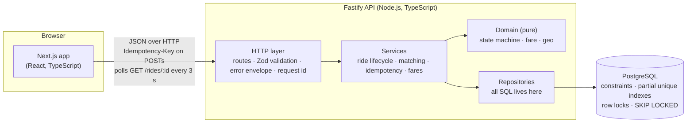
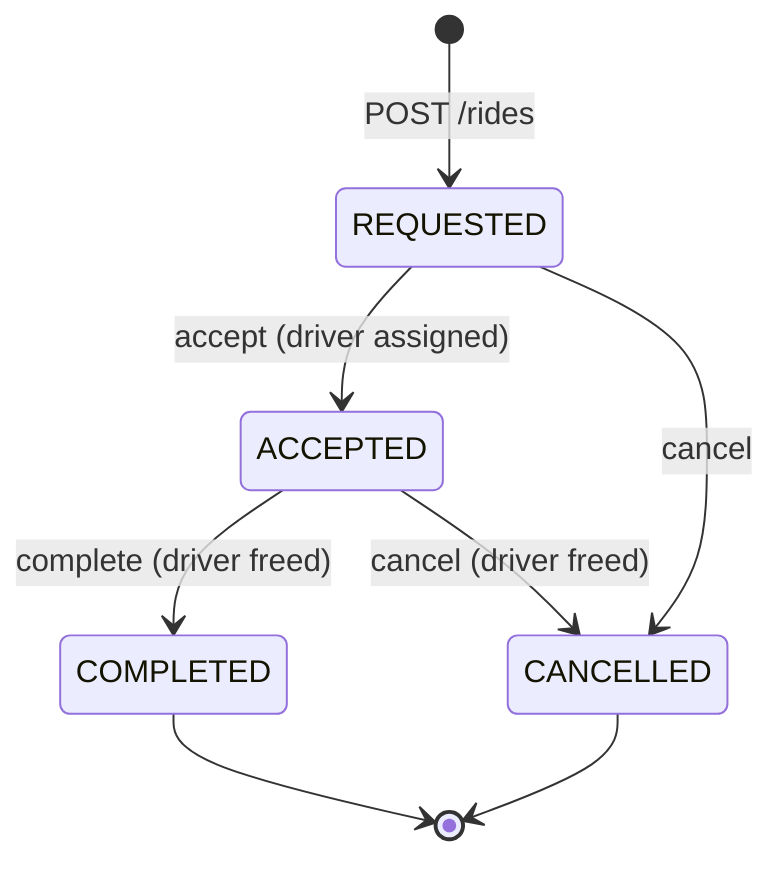

# Architecture & design notes

## Overview

| Layer | Folder | Responsibility | Knows about |
|---|---|---|---|
| Frontend | `apps/web/src` | UI states, client-side validation, retries | API contract only |
| HTTP | `apps/api/src/http` | Parse + validate input, map errors to HTTP | Services |
| Services | `apps/api/src/services` | Transactions, locking order, business rules | Domain, repositories |
| Domain | `apps/api/src/domain` | Pure rules: transitions, fares, geo | Nothing (no I/O) |
| Persistence | `apps/api/src/repositories`, `migrations/` | SQL, schema, integrity constraints | Postgres |

### Ride lifecycle

The table lives in one place (`domain/rideStateMachine.ts`). The API returns `allowedActions` on every ride, so the UI never has to duplicate the rules. The database repeats them as a `CHECK` constraint (`rides_status_shape`): an `ACCEPTED` row without a driver, or a `COMPLETED` row without a final fare, cannot be stored.

### Data model

| Table | Purpose | Key integrity rules |
|---|---|---|
| `riders` | Riders | unique phone |
| `drivers` | Drivers, category, status (`OFFLINE`/`AVAILABLE`/`ON_TRIP`), location | partial index on available drivers per category |
| `fare_rates` | Pricing per category (integer PKR) | non-negative checks |
| `rides` | Request, current driver assignment, fare snapshot, timestamps | `rides_status_shape` CHECK; **one active ride per rider**; **one active ride per driver** (partial unique indexes) |
| `ride_events` | Append-only audit log of every transition (who, when, which driver) | FK to rides |
| `idempotency_keys` | Stored responses for retried POSTs | PK `(scope, key)` |

---

## 1. Why this technology stack and architecture?

- **TypeScript end to end.** One language for the web app, the API and the tests; request/response types are mirrored on both sides, and one engineer can work across the stack.
- **Next.js + React** (frontend): the preferred stack in the brief. The app is a single client-rendered page; the framework gives production builds, routing and good defaults with no extra setup.
- **Fastify** (backend): small, fast, and explicit. It has no hidden magic, so the code shows the important decisions directly: transaction boundaries, lock order, error mapping. `app.inject()` lets integration tests exercise the real HTTP stack in-process. NestJS would add structure that this scope does not need.
- **PostgreSQL**: the correctness requirements (no double assignment, no duplicate rides, valid transitions) are exactly what a relational database guarantees well: transactions, row locks, `SKIP LOCKED`, `CHECK` constraints, partial unique indexes. Putting the invariants in the database means they hold even if application code has a bug or a second service writes to the same tables.
- **Plain SQL (`pg`) instead of an ORM**: the locking queries (`FOR UPDATE SKIP LOCKED`, compare-and-set updates) are the heart of the problem, and they should be visible and reviewable rather than generated.
- **Zod** for runtime validation, giving one schema per endpoint and precise per-field errors.
- **A modular monolith**: one deployable with strict internal layers. It is the simplest thing that is correct, and the layer boundaries are where services could be split later (see Q6).

## 2. How do you prevent two drivers from accepting the same ride?

There are three layers, each sufficient on its own for the common case:

1. **Row lock on the ride.** `acceptRide` runs in one transaction and starts with `SELECT … FROM rides WHERE id = $1 FOR UPDATE`. A second concurrent accept blocks there. When it proceeds, it re-reads the ride, sees `ACCEPTED`, and the state machine rejects it with `409 INVALID_STATE_TRANSITION`.
2. **Compare-and-set update.** The write is `UPDATE rides SET status='ACCEPTED' … WHERE id=$1 AND status='REQUESTED'`. If zero rows change, the transition is refused.
3. **Database constraints.** A partial unique index `rides_one_active_per_driver ON rides(driver_id) WHERE status='ACCEPTED'` makes it impossible for one driver to hold two active rides. `rides_status_shape` makes an accepted ride without a driver unstorable.

The reverse problem is two rides grabbing the same driver. For automatic dispatch, the nearest driver is selected with `… ORDER BY distance LIMIT 1 FOR UPDATE SKIP LOCKED`, so concurrent matchers skip a driver another transaction is assigning and take the next one. When a specific driver accepts, that driver's row is locked with `FOR UPDATE` and its status is re-checked.

**Deadlocks** are avoided by a single global lock order: ride row first, then driver row, in every operation (accept, cancel, complete).

**Verified by tests** (`apps/api/test/integration/concurrency.test.ts`):
- 10 drivers accept one ride simultaneously: exactly 1 succeeds, 9 get 409, exactly one driver is `ON_TRIP`, and one `ACCEPTED` event is logged.
- 8 rides are auto-dispatched at once to 5 drivers: 5 distinct drivers are assigned, never one driver twice, and 3 rides get `NO_DRIVERS_AVAILABLE`.
- Mutation check: removing the ride lock and the compare-and-set makes the first test fail.

## 3. How do you handle retries and duplicate requests?

**Idempotency keys** (the same pattern Stripe uses):
- The client generates an `Idempotency-Key` (UUID) per user intent. It is **required** on `POST /rides` and optional on accept/cancel/complete.
- The key is claimed **inside the same transaction** as the business change (`INSERT … ON CONFLICT DO NOTHING` into `idempotency_keys`), and the response is stored in that transaction. As a result:
  - **Retry after success:** the stored response is replayed with `Idempotent-Replayed: true`. Nothing runs twice.
  - **Retry after failure:** the key was rolled back with the failed transaction, so the retry runs fresh. This matters because failures like `NO_DRIVERS_AVAILABLE` are transient.
  - **Two identical requests at the same instant:** the second blocks on the key's primary key until the first commits, then replays its response.
  - **Same key, different body:** `422 IDEMPOTENCY_KEY_REUSED`, which surfaces a client bug.
- Keys are scoped (`POST /rides|rider:<id>`, `POST /rides/<id>/cancel`), so clients cannot collide across riders or actions.

**Duplicates with different keys** (e.g. two tabs) are stopped by the domain rule "one active ride per rider", enforced by the unique index `rides_one_active_per_rider`. The loser receives `409 ACTIVE_RIDE_EXISTS` with the existing ride's id, and the web app opens that ride.

**Verified by tests:** 10 simultaneous submissions with one key produce one ride and ten identical 201s; 10 with different keys produce one 201 and nine 409s. The Playwright E2E test drops the HTTP response after the server created the ride; the browser retries with the same key, the server replays, and exactly one ride exists.

## 4. How does the frontend respond when an API request fails?

- **Single API client** (`apps/web/src/lib/api.ts`): every call has an 8 s timeout and every failure becomes an `ApiError` with the server's error `code`.
- **Automatic retry only where it is safe:** network errors and 5xx are retried twice with exponential backoff (300 ms, 600 ms), but only for `GET`s and `POST`s that carry an Idempotency-Key. 4xx errors are never retried.
- **Idempotency key per intent:** after a network failure the "Request" button reuses the same key, so a manual retry also cannot double-book. After a definite rejection (4xx), the next attempt gets a new key.
- **Human messages:** codes map to actionable text, e.g. `NO_DRIVERS_AVAILABLE` becomes "No drivers are available nearby right now…". Internal server messages are never shown for 5xx.
- **Explicit UI states:** loading (spinners, disabled buttons, `aria-busy`), empty ("Choose a pickup and destination…"), error (`role="alert"` with a **Try again** action), and success.
- **Status polling degrades gracefully:** if `GET /rides/:id` fails, the last known state stays on screen with a "Connection lost… retrying" notice, which clears automatically on recovery.
- **Conflicts resolve to the truth:** if a cancel races with completion (`INVALID_STATE_TRANSITION`), the app refetches and shows the real status.
- **Reload safe:** on load, the app calls `GET /riders/:id/active-ride` and resumes any ride in progress.

## 5. How would you scale to multiple cities and thousands of concurrent users?

1. **Stateless API, horizontally scaled** behind a load balancer. Nothing is held in process memory, so instances can be added freely. Add **PgBouncer** (transaction pooling) so many instances share a bounded number of Postgres connections.
2. **City as a first-class dimension.** Add a `cities` table with a service-area polygon and per-city fare rates, and put a `city_id` on drivers and rides. Matching is always within a city, so the workload partitions naturally. Indexes become `(city_id, category, status)`. At larger scale, partition `rides` by city or time, or run a database per region.
3. **Real geospatial matching.** Move to **PostGIS**: a `geography(Point)` column with a GiST index and `ST_DWithin` plus `ORDER BY location <-> pickup`, which is index-assisted nearest-neighbour search. For high-frequency driver location updates (every few seconds × thousands of drivers), keep live locations in **Redis GEO** or bucket drivers into **H3 cells**, and use Postgres only to lock and assign.
4. **Push instead of poll.** Replace 3 s polling with WebSockets or SSE fed by ride events, which removes most read traffic.
5. **Reads off the primary.** History and admin views go to read replicas. The hot path (create, accept) stays on the primary because it needs locks.
6. **Async dispatch.** Instead of "accept = instantly assign", offer the ride to the best driver with a timeout and fall back to the next. This becomes a queue/worker workflow (see Q6).
7. **Housekeeping.** Expire stale `REQUESTED` rides and purge old idempotency keys with scheduled jobs, and archive `ride_events`.

## 6. When would you introduce Redis, a message broker, or separate services?

When a measured need appears, not before. Each adds operational cost and failure modes.

- **Redis**
  - Live driver locations once updates reach hundreds or thousands per second (Redis GEO / H3 buckets), keeping that write load off Postgres.
  - Distributed **rate limiting** across API instances.
  - Caching hot, rarely changing reads (fare rates, city config).
  - WebSocket fan-out (pub/sub) across instances.
  - Correctness locks stay in Postgres; I would not move ride/driver assignment into Redis locks.
- **Message broker (SQS / RabbitMQ / Kafka)**
  - When work becomes asynchronous or multi-consumer: driver offers with timeouts, push notifications/SMS, receipts, analytics, and fraud signals.
  - Publish via a **transactional outbox**: write the event to an `outbox` table (or reuse `ride_events`) in the same transaction as the state change, and relay it to the broker. This avoids lost or phantom events.
- **Separate services**
  - When parts need **different scaling or ownership**. The first candidates are a **location/dispatch service** (very write-heavy, latency-sensitive) and **payments** (compliance, external providers).
  - The current layer boundaries (services, repositories) are the seams to split along. Until then, a modular monolith is simpler to run, test and debug.

## 7. How would you deploy, monitor and roll back?

**Deploy**
- CI on every PR: typecheck, unit and integration tests against a Postgres service container, Playwright E2E, and a dependency/secret scan.
- Build **immutable, versioned container images** for the API and web. Configuration comes only from environment variables and secrets from a secrets manager (as in this repo: `.env` is git-ignored and `.env.example` documents keys).
- Run **migrations as a separate step before rollout**, written **expand/contract**: add columns or tables first, deploy code that uses them, and remove old ones in a later release. This keeps the previous version compatible with the new schema, which is what makes rollback safe.
- Roll out **rolling or canary** (e.g. 5% → 25% → 100%) on ECS/Kubernetes, gated on health checks (`/health` checks DB connectivity) and error-rate SLOs. The web app can go to Vercel or the same platform.

**Monitor**
- **Structured JSON logs** (pino) with a `requestId` on every line and in every error response, so a user report maps straight to the logs.
- **Metrics:** RED per endpoint (rate, errors, duration) plus business signals: rides requested, accept latency, `NO_DRIVERS_AVAILABLE` rate, cancellation rate, idempotent replays, and DB pool saturation or lock waits.
- **Tracing:** OpenTelemetry across web → API → DB.
- **Alerts** on SLO burn (5xx rate, p95 latency), DB health, and anomalies such as a sudden spike in `NO_DRIVERS_AVAILABLE`.

**Roll back**
- Redeploy the previous image tag. Because migrations are backward compatible, no database rollback is needed.
- Canary auto-rollback on SLO breach. **Feature flags** let risky behaviour (e.g. a new matching algorithm) be switched off without a deploy.

## 8. The three most important improvements before production

1. **Authentication and authorization.** Today the rider is identified by a `riderId` in the request body, and any caller can accept or complete a ride. Production needs authenticated riders and drivers (JWT/OAuth), the rider id taken from the token, driver-only endpoints for accept and complete (a driver may only complete their own ride), and rate limiting per user and IP.
2. **Real dispatch and ride expiry.** Replace instant assignment with driver **offers** (accept/decline with a timeout, then the next-best driver), PostGIS or Redis-backed nearby search, and a scheduled job that expires rides stuck in `REQUESTED` and notifies the rider. Push status over WebSockets instead of polling.
3. **Operational hardening.** Metrics, tracing and alerting (Q7), a CI/CD pipeline with expand/contract migrations, scheduled cleanup of `idempotency_keys`, PgBouncer, backups with tested restores, and load tests that run the concurrency scenarios at realistic volume.

---

## Key trade-offs and assumptions

| Decision | Why | Cost / what changes in production |
|---|---|---|
| Lock rows in Postgres (no Redis locks) | One source of truth; invariants hold across any number of API instances | Postgres becomes the contention point; fine at city scale, partition by city beyond |
| `SKIP LOCKED` for dispatch | Concurrent matchers never wait on each other | Under extreme contention a request may see "no driver" while one is being released; the client retries |
| Final fare = quoted fare | No trip tracking in scope | Real fare needs route, time and waiting charges |
| Distance = straight line × 1.3, speed 22 km/h | No routing engine in scope | Use OSRM / Google Directions for distance and ETA |
| Places from a fixed list | No geocoding in scope | Google Places / Mapbox autocomplete |
| Polling every 3 s | Simple and robust | WebSockets/SSE at scale |
| `Idempotency-Key` required only on `POST /rides` | Highest double-submit risk; transitions are also protected by the state machine | Could be required on all POSTs |
| `NO_DRIVERS_AVAILABLE` returns 409, ride stays `REQUESTED` | The rider can retry or cancel; no ride is lost | Real dispatch keeps searching asynchronously |
